# Database

PostgreSQL, accessed through EF Core (`api/src/DevSheet.Infrastructure/Persistence/AppDbContext.cs`).
The full DDL is in [`schema.sql`](schema.sql). It is **generated from the EF model** and a test
(`SchemaScriptTests`) fails if the model changes without the file being regenerated:

```bash
cd api && UPDATE_SCHEMA=1 dotnet test --filter SchemaScriptTests
```

Connect locally with `docker compose exec db psql -U devsheet -d devsheet`
(host `localhost`, port `5432`, database/user/password `devsheet`). Table names are quoted and
capitalized, e.g. `SELECT * FROM "Users";`.

## Entity-relationship diagram

```mermaid
erDiagram
    Users ||--o| PasswordLogins : "signs in with"
    Users ||--o{ ExternalLogins : "signs in with"
    Users ||--o{ AccountTokens : "emailed links"
    Users ||--o| GithubConnections : "syncs from"
    Users ||--o| Profiles : has
    Users ||--o{ GithubRepos : "synced from GitHub"
    Users ||--o{ Projects : owns
    Users ||--o{ WorkExperiences : has
    Users ||--o{ Educations : has
    Users ||--o{ Languages : speaks
    Users ||--o{ Certifications : holds
    GithubRepos |o--o{ Projects : "backs"
    Projects ||--o{ ProjectSkills : uses
    Skills ||--o{ ProjectSkills : "linked by"
    Skills ||--o{ SkillAliases : "known as"

    Users {
        uuid Id PK
        text DisplayName
        text Email "private, never used to match accounts"
        text AvatarUrl
        text Slug UK "public URL"
        boolean IsPublished "opt-in"
        timestamptz CreatedAt
        timestamptz OnboardingCompletedAt "null until the welcome flow is finished or skipped"
        integer OnboardingStep "welcome step last reached"
        varchar SecurityStamp "in the cookie; changed to sign out other sessions"
    }
    PasswordLogins {
        uuid UserId PK,FK
        varchar Email
        varchar NormalizedEmail UK "trimmed, upper case"
        text PasswordHash "PBKDF2 (ASP.NET Core PasswordHasher)"
        timestamptz EmailConfirmedAt "null: cannot sign in yet"
        timestamptz CreatedAt
        timestamptz PasswordChangedAt
    }
    AccountTokens {
        uuid Id PK
        uuid UserId FK
        varchar Purpose "ConfirmEmail | ResetPassword"
        varchar TokenHash UK "SHA-256; the token is only in the email"
        timestamptz CreatedAt
        timestamptz ExpiresAt
        timestamptz UsedAt "used, or replaced by a newer one"
    }
    ExternalLogins {
        uuid Id PK
        uuid UserId FK
        varchar Provider "google | apple"
        text ProviderKey "provider's stable user id"
        text Email
        timestamptz CreatedAt
    }
    GithubConnections {
        uuid UserId PK,FK
        bigint GithubId UK "stable, logins can change"
        text Login
        text EncryptedToken "Data Protection, never sent to browser"
        timestamptz ConnectedAt
        timestamptz LastSyncedAt
    }
    Profiles {
        uuid Id PK
        uuid UserId FK,UK
        text FullName
        text Headline
        text Summary
        text Location
        text Email
        boolean ShowEmailPublicly "opt-in, default false"
        boolean ShowLocationPublicly "opt-in, default false"
        text Website "shown on the public page"
        text Phone "international, +359 ..."
        text CountryCode "ISO 3166-1 alpha-2, lower case"
        boolean ShowPhonePublicly "opt-in, default false"
        boolean AllowPublicCvDownload "opt-in, default false"
    }
    GithubRepos {
        uuid Id PK
        uuid UserId FK
        bigint GithubRepoId "unique per user"
        text Name
        text Description
        text HtmlUrl
        int Stars
        boolean IsFork
        timestamptz PushedAt
        text LanguagesJson "language -> bytes"
        text ETag
        boolean SourceMissing
    }
    Projects {
        uuid Id PK
        uuid UserId FK
        uuid GithubRepoId FK "nullable"
        text TitleOverride
        text DescriptionOverride
        int Status "0 Pending, 1 Visible, 2 Hidden"
        int DisplayOrder
    }
    Skills {
        uuid Id PK
        text Name UK
        text EscoUri "nullable, future ESCO mapping"
    }
    SkillAliases {
        uuid Id PK
        uuid SkillId FK
        text Alias UK "normalized lower-case"
    }
    ProjectSkills {
        uuid ProjectId PK,FK
        uuid SkillId PK,FK
        int Status "0 Suggested, 1 Confirmed, 2 Rejected"
    }
    WorkExperiences {
        uuid Id PK
        uuid UserId FK
        text Company
        text Title
        date StartDate
        date EndDate "null = present"
        text Description
    }
    Educations {
        uuid Id PK
        uuid UserId FK
        text Institution
        text Degree
        date StartDate
        date EndDate
    }
    Languages {
        uuid Id PK
        uuid UserId FK
        text Name
        text IsoCode "optional ISO 639-1"
        boolean IsMotherTongue
        int Listening "CEFR 1=A1 .. 6=C2, nullable"
        int Reading "nullable"
        int SpokenInteraction "nullable"
        int SpokenProduction "nullable"
        int Writing "nullable"
    }
    Certifications {
        uuid Id PK
        uuid UserId FK
        text Name "Europass: Title"
        text Issuer "Europass: AwardingBody"
        date IssueDate "nullable"
        text Url "nullable, DevSheet addition"
    }
```



## Design notes

- **Two data layers.** `GithubRepos` is a read-only copy of GitHub data; only the sync job writes it.
  `Projects` is the user-owned layer (title/description overrides, status, order). Re-sync never
  touches `Projects`, so user edits survive.
- **Approve-first.** New repos create a `Projects` row with `Status = 0 (Pending)`. Only `Status = 1 (Visible)`
  projects appear on the public page or in a CV.
- **Skill links keep their state.** `ProjectSkills` rows are never deleted by sync. `Rejected` rows are
  kept so a dismissed suggestion is not proposed again; `Confirmed` rows survive even if the language
  later disappears from the repo.
- **Skills are canonical.** `Skills` is a seeded list; `SkillAliases` maps alternative spellings and
  GitHub language names (e.g. `dockerfile`, `plpgsql`) to a skill. Skills are never created from raw GitHub strings.
- **Privacy flags.** `Profiles.ShowEmailPublicly`, `ShowLocationPublicly` and `ShowPhonePublicly` default to false; the
  public page and the public CV download omit email, location (with the country) and phone unless the owner opts in. Name, headline and summary are public once the page is published.
- **Languages mirror Europass.** A foreign language is self-assessed in five skills, each an optional CEFR level stored as an
  integer (1 = A1 ... 6 = C2); a native language has no levels. See `docs/EUROPASS.md`.
- **Accounts.** A user is a DevSheet account on its own. It signs in with email and password (`PasswordLogins`, 0 or 1,
  unique by normalised email) and/or with providers (`ExternalLogins`, unique by (`Provider`, `ProviderKey`); the key is
  the provider's stable user id, never the email). Provider sign-ins are **never matched by email**: a Google sign-in
  with the same email as a password account makes a separate account (linking happens only while signed in).
  GitHub is **not** a sign-in method (migration `PasswordAccounts` removed the old GitHub logins); it is only a
  connection, below.
- **Passwords and emailed links.** Only a PBKDF2 hash of the password is stored. Confirm-email and reset-password links
  carry a random token; `AccountTokens` keeps only its SHA-256, an expiry and when it was used, so a copy of the
  database cannot be used to take over accounts. `Users.SecurityStamp` is in the sign-in cookie; changing it on a
  password reset or change signs out every other session.
- **GitHub is a connection.** `GithubConnections` (0 or 1 per user) holds the GitHub account repos are synced from and
  its encrypted token, keyed by GitHub's numeric id (logins can change). One GitHub account feeds at most one DevSheet
  account. `Slug` is a separate, unique, public value (3-30 lowercase letters, digits, hyphens; not a reserved route).
- **Deletes.** Deleting a user cascades to everything they own. `Projects.GithubRepoId` has no cascade:
  a repo row cannot be deleted while a project references it (repos that vanish from GitHub are flagged
  `SourceMissing`, not deleted).
- **Migrations.** The schema is managed with EF Core migrations (see the README for the commands). Development
  applies them on start; production runs `DevSheet.Api --migrate` as a separate step. Local databases created
  with `EnsureCreated()` before issue #13 are recognised and marked as being at `InitialCreate`, so their data is kept.
